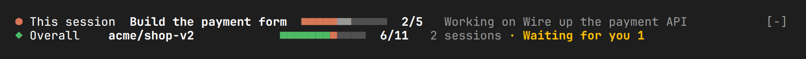
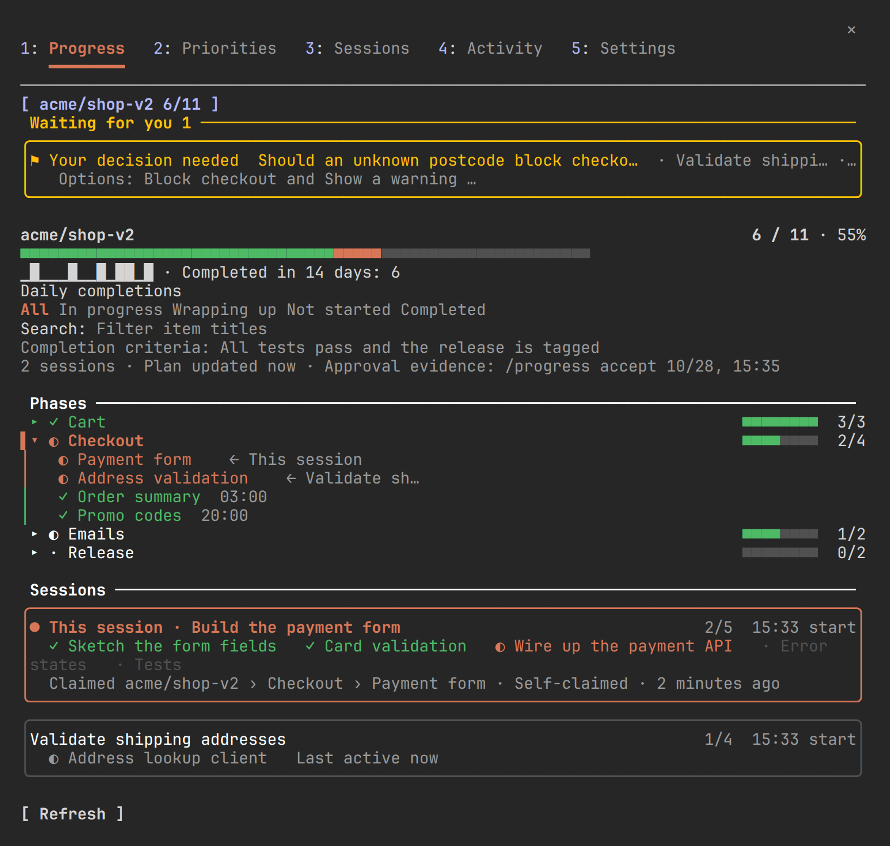

# progress-board

A Claude Code mod that shows what this session is doing, how far the overall plan has come, and what is waiting for you.

It reads ordinary Claude Code events, your project files, git and (optionally) the GitHub CLI. No particular workflow or planning tool is required.

## What it does

**A two-line band above the prompt.** The first line is this session: its goal, finished steps, current step and background work. The second line is the overall plan: done and planned items, active sessions and a **Waiting for you** count. Only that count asks you to act.



**A `/progress` panel with five tabs:**

| Tab | Shows |
|---|---|
| Progress | Every active plan, a 14-day completion history, phases, search and filters, what happened while you were away |
| Priorities | Open work from pinned to deferred; change priorities and dispatch an item now |
| Sessions | Each session's model, cost, context use, current step and last reply; compact, interrupt, check progress or send a message |
| Activity | Seven days of completions, events and decisions |
| Settings | Every option with its choices and a short explanation, plus which features use tokens |



**Also:**

- Import a plan from GSD, spec-kit, Kiro, Taskmaster, Markdown checklists or GitHub milestones and issues.
- Write a Markdown progress report with `/progress report`.
- Optional toast or sound when something new is waiting for you.
- Pull request and branch checks move items forward when work is merged.
- Ten bundled languages, with machine translation for others.

## Install

At the Claude Code prompt:

```
/plugin install progress-board --marketplace wisdommen/progress-board
```

From a shell:

```
claude plugin install progress-board --marketplace wisdommen/progress-board
```

In the desktop app, where `/plugin` does not run: click **+** next to the prompt box, then **Plugins**, **Add marketplace** with `wisdommen/progress-board`, then **Add plugin**.

During installation Claude Code asks you to add the marketplace (press `y`), to choose where to install ("Install for you" is fine) and to review the plugin's options. The defaults work, so you can save them unchanged; you can change them later in the Settings tab. The plugin is active in that session right away; restart other running sessions to load it there.

## Quick start

1. Start a session and give it a multi-step task. The model records a goal and steps, and the band fills in.
2. Ask the model to propose a plan, or run `/progress import` in a project that already has one. Accept the draft with `/progress accept`.
3. Open `/progress` to see everything; press `1`–`5` to switch tabs.

## Commands

| Command | Purpose |
|---|---|
| `/progress` | Open the panel |
| `/progress accept [plan]` / `reject [plan] [reason]` | Accept or reject a draft plan |
| `/progress review` | List changes awaiting review (`undo N`, `ok`) |
| `/progress find [text]` | Filter items by title |
| `/progress report [plan]` | Write a Markdown progress report |
| `/progress import [path\|source]` | Import a plan as a draft |
| `/progress send <session>: <message>` | Prepare a message to another session |
| `/progress lang <code\|follow\|retranslate>` | Choose the display language |

## Costs

Most of the mod is free: it reads local files and events. Features that use tokens are marked with **$** in the panel and listed at the top of Settings. The optional background monitor uses Haiku only when the evidence has changed, typically well under one cent per run. Compact, check progress, messages and dispatch run a turn in the target session and count against its usage.

## Documentation

Full documentation is in the [wiki](https://github.com/wisdommen/progress-board/wiki): every tab and setting, how priorities and dispatch work, cross-session controls and their security model, imports, storage and known limitations. A [Chinese introduction](https://github.com/wisdommen/progress-board/wiki/%E4%B8%AD%E6%96%87%E4%BB%8B%E7%BB%8D) is also available.

## Requirements

- Claude Code with mod support (tested on 2.1.311).
- `git` for commit and branch checks; the GitHub CLI `gh` for pull request checks and GitHub imports (optional).

## License

[MIT](LICENSE)
